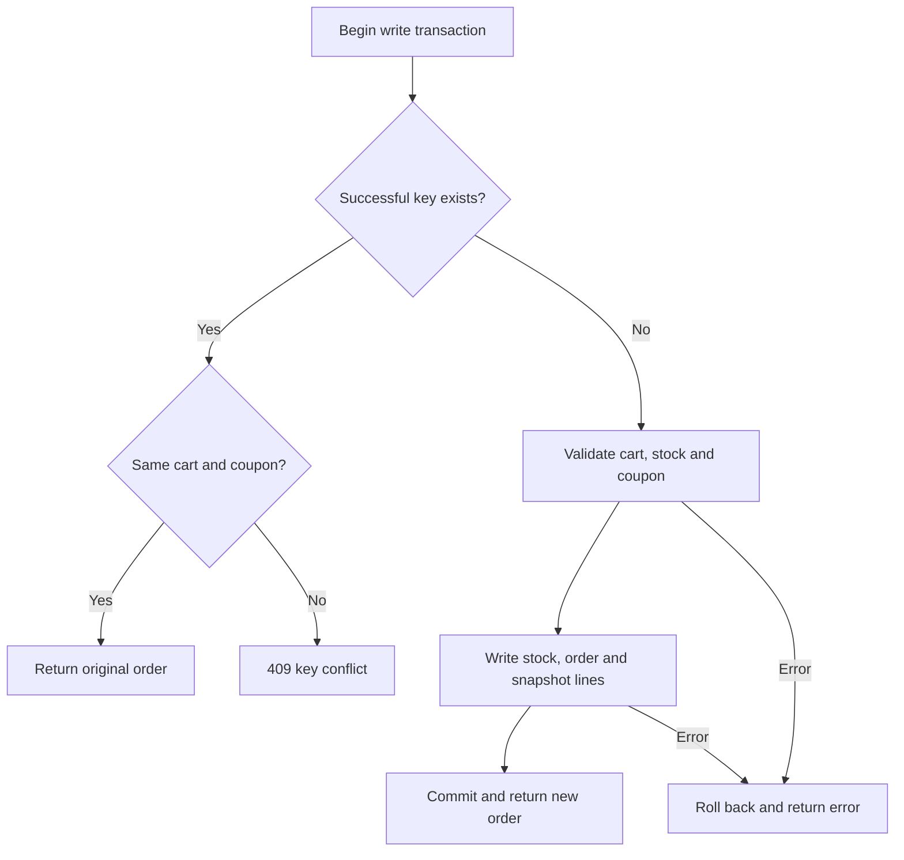

# Understand the checkout service

The goal is to explain and change this code in your own words. Run `npm test`
and `npm run demo`, then keep `src/service.js`, `src/database.js` and
`src/schema.sql` open. Learn the HTTP adapter after the checkout rules make sense.

## 1. What are we protecting?

An **invariant** is a rule that must remain true after every completed operation,
including a failed operation or two requests happening together.

“Stock never goes below zero” is an invariant. “Return a list of products” is a
feature. The assignment evaluates whether implementing the feature can
accidentally break the invariant.

Ask five questions when reading a mutation:

1. Can this sell stock that no longer exists?
2. Can this purchase the same cart a second time?
3. Can this redeem a coupon twice or lose it on failure?
4. Can a retry produce another order?
5. Can the report explain the purchase afterwards?

Consider a lamp with one unit left. A and B both add it to their carts. Both adds
can succeed: carts do not reserve inventory. At checkout, exactly one buyer may
purchase it; the other receives `INSUFFICIENT_STOCK`.

## 2. Read the project in this order

| File | Responsibility |
| --- | --- |
| `src/schema.sql` | What facts exist and what the database forbids |
| `src/money.js` | Subtotal, discount and final total calculations |
| `src/database.js` | Open the database, seed once, commit/roll back work |
| `src/service.js` | Business rules, especially `checkout()` |
| `src/errors.js` | Useful errors and common input checks |
| `src/http.js` | Translate HTTP into service calls and responses |
| `src/server.js` | Configuration, startup and shutdown |
| `test/*.test.js` | Evidence for the rules and failure behavior |

`createService(db)` receives the database instead of opening one itself. This is
**dependency injection**: passing a dependency in. Tests pass a fresh database;
the real server passes a persistent database. No framework is needed for this.

## 3. Understand the data before the functions

| Table | One row means | Relationship |
| --- | --- | --- |
| `settings` | The reward program's n and x | One settings row |
| `products` | Current product and available stock | Referenced by cart/order lines |
| `carts` | A cart exists | Many lines, at most one order |
| `cart_items` | One product/quantity in a cart | Unique cart/product pair |
| `coupons` | One reward for one milestone | At most one redeeming order |
| `orders` | One committed successful purchase | Unique cart, key and optional coupon |
| `order_items` | What a product cost in that purchase | Historical snapshot |

Four important SQL constraints:

- `PRIMARY KEY` identifies a row, such as a product ID.
- `REFERENCES` creates a foreign key: a line cannot point to a nonexistent cart
  or product. It does not copy current product prices into history; we do that.
- `UNIQUE` prevents another order using the same cart, key or non-null coupon.
  SQLite allows multiple NULL values in a UNIQUE column, so orders without
  coupons do not conflict with one another.
- `CHECK` rejects values violating a condition, such as negative inventory.

The service checks provide helpful errors; database constraints are another
boundary if application code changes incorrectly. A constraint alone does not
replace the full checkout transaction.

There is no `coupon.used` flag. To know whether a coupon was used, look for an
order with its `coupon_code`. There is one source of truth. The same reasoning
applies to a cart's `CHECKED_OUT` status.

## 4. Money: follow actual values

`"105"` means 105 paise, or INR 1.05, not 105 rupees. Quantities are normal
numbers; monetary values are serialized as integer strings.

For two stickers at 105 paise each with a 10% coupon:

```js
const subtotal = 105n * 2n;                 // 210 paise
const discount = (210n * 10n + 50n) / 100n; // 21 paise
const total = 210n - 21n;                  // 189 paise
```

The `n` suffix means JavaScript **BigInt**, an exact integer. BigInt division
discards the fractional part; adding 50 before dividing by 100 implements
half-up rounding for the nonnegative amounts used here.

For one sticker, `(105n * 10n + 50n) / 100n` is `11n`. The exact discount is
10.5 paise, which rounds up. For two stickers we round the combined subtotal
once: the discount is 21, not twice 11.

`JSON.stringify` cannot directly serialize BigInt, so `money.js` calls
`.toString()`. This also keeps large report totals exact. Clients format paise
strings for display; converting a huge report total to Number can lose precision.

The database stores integer paise. Individual order amounts are bounded below
Number's safe integer limit, so reading them as Number and converting to BigInt
is exact here. Cumulative revenue is summed with BigInt.

## 5. Trace checkout from HTTP to commit

Assume the cart holds two mugs at 34,900 paise each and a valid 10% coupon exists:

```http
POST /carts/CART_ID/checkout
Content-Type: application/json
Idempotency-Key: my-mug-checkout

{"couponCode":"COUPON_CODE"}
```

Replace the placeholders with real values. Start at the checkout route in
`http.js`, then follow `service.checkout()`:

| Step | Code behavior | Purpose |
| --- | --- | --- |
| 1 | Read JSON; validate ID, body, key and coupon syntax | Reject malformed requests before database work |
| 2 | Build `JSON.stringify([cartId, couponCode])` | Identify the request the key belongs to |
| 3 | Enter `write(...)`, then `transaction(...)` | Acquire the write transaction before checking mutable facts |
| 4 | Look up the successful key | Recover an earlier success before rejecting used resources |
| 5 | If no prior success, require an existing open cart | A new key cannot repurchase a cart |
| 6 | Read items; reject empty cart or insufficient stock | Cart contents are not a reservation |
| 7 | Check coupon exists and has no redeeming order | Reject invalid/used coupons |
| 8 | Calculate 69,800 subtotal, 6,980 discount, 62,820 total | Use server prices and the coupon's saved percentage |
| 9 | Deduct stock using `WHERE inventory >= ?` | Update only when the database condition holds |
| 10 | Insert order and snapshot lines | Save history, successful key and redemption together |
| 11 | Commit, then return 201 with the Order | Send success after persistence succeeds |

If an exception occurs before commit, the transaction helper rolls back if
needed and rethrows it. HTTP returns the domain error or sanitized 500. It does
not return a partially successful order.



The replay path exits the transaction wrapper cleanly without new domain writes.
A commit failure is also handled by the wrapper rather than returning success.

## 6. Transactions and idempotency solve different problems

A **transaction** groups related changes into one unit: stock deduction, order,
lines and coupon redemption must succeed together. If the last line insert
fails, earlier writes must not remain.

**Idempotency** defines what happens when the same logical operation is sent
again. Even a correct transaction needs it: the response can be lost after commit.

| Event | Server state | Retry behavior |
| --- | --- | --- |
| Failure before commit | No order/key/redemption; stock restored | May try checkout again |
| Commit succeeds; response arrives | One saved order/key | Return that order if repeated |
| Commit succeeds; response is lost | The same saved order/key | Recover that order |
| New key on a purchased cart | Cart already has an order | 409 with original order ID |

Why look up the key before checking whether the cart/coupon is used? A valid
retry refers to resources already used by its own original order. Checking
usage first would incorrectly reject the retry we should recover.

Why no cryptographic hash? The fingerprint compares two short fields for
equality; it is not password storage or tamper protection. No secrets are encoded.

Only successful keys are saved. Temporary stock failure does not permanently
bind a key to an error. Some payment APIs remember more outcomes; that would
need a separate attempt table and a different contract.

## 7. Predict overlapping requests

### Two buyers, one lamp

| Moment | Buyer A | Buyer B |
| --- | --- | --- |
| Both request checkout | Obtains `BEGIN IMMEDIATE` | Waits for write transaction |
| A checks stock | Reads 1, deducts 1, inserts order | Cannot perform competing write yet |
| A commits | Committed stock becomes 0 | Acquires write transaction |
| B checks stock | Finished | Reads 0, returns 409, no purchase |

Either buyer can win. The rule is one winner, not a predetermined buyer. Lock
timeout can instead yield retryable 503.

For **one coupon**, the first writer commits its order/coupon relationship. The
second sees it and receives `COUPON_ALREADY_REDEEMED`, with no stock deduction.
The UNIQUE coupon column is a second line of defense.

For **coupon generation**, if only milestone 5 is eligible, only one caller
succeeds. If 5 and 10 are both eligible, two callers can each succeed for a
different milestone. That still means one coupon per milestone.

### Isn't Node.js single-threaded?

One worker generally executes one JavaScript callback at a time, but async waits
allow other requests to progress. Two workers or application instances have
different event loops. A process-local variable/mutex cannot coordinate them.

Our database callbacks are synchronous and do not `await`. This avoids sharing
an open connection across overlapping asynchronous work. The correctness
boundary is still the database lock and constraints. Tests intentionally use
two workers, each with its own connection and HTTP server, to exercise it.

The cost is performance: synchronous SQLite can block the event loop, including
while waiting for a lock. Be able to explain that weakness. Sharing one local
file is not a multi-machine deployment strategy.

## 8. SQL and JavaScript patterns used here

| Pattern | Meaning |
| --- | --- |
| `db.prepare(sql)` | Prepare SQL with placeholders for data |
| `.get(value)` | Read one row, or `undefined` if absent |
| `.all(value)` | Read matching rows into an array |
| `.iterate()` | Walk rows without building a whole array first |
| `.run(a, b)` | Execute a write with positional parameters |
| `result.changes` | Number of rows changed; zero can mean a condition failed |
| `?` in SQL | Bind a value as data rather than concatenating SQL |
| `check(condition, status, code, message)` | Throw `ApiError` when the condition is false |
| `fields(body, allowed, required)` | Reject malformed bodies, missing and extra keys |
| `Object.hasOwn(body, key)` | Distinguish an explicit field from an absent one |
| `value ?? fallback` | Use fallback for null/undefined while preserving valid zero |
| `{ ...totals }` | Copy calculated amount fields into the response object |
| `.map(orderView)` | Convert database rows to documented response objects |
| `Promise.all(requests)` | Start overlapping requests and await all responses |
| `try` / `catch` / `finally` | Attempt work, handle errors, always clean up |

For this query, buying two mugs binds `(2, 'mug', 2)`:

```sql
UPDATE products SET inventory = inventory - ?
WHERE id = ? AND inventory >= ?
```

If fewer than two units exist, no row changes. `changes === 1` confirms success.
This condition and the database CHECK are separate from friendly validation.

`async` appears in HTTP body reading/tests because they wait for networking.
`checkout()` is synchronous. Marking every function `async` would change the
transaction behavior; it is not a harmless stylistic change.

## 9. Understand what the tests prove

The rollback test in `test/service.test.js` deliberately fails during the second
product's order-line insert. Stock and the order row have already changed inside
the transaction. It checks that nothing survives, and the same key/coupon can
succeed after removing the failure. This reaches the dangerous failure point
rather than testing only initial validation.

The automatic-rollback regression reproduces a bug in the first generated
helper: a second ROLLBACK hid the original error. Temporarily remove
`if (db.isTransaction)` in the catch block to reproduce it, then restore it:

```sh
node --test --test-name-pattern="automatic SQLite rollback" test/service.test.js
```

In `test/concurrency.test.js`, `cluster()` and the worker fixture create two real
connections to the same SQLite file. The held-lock test deliberately keeps a
write transaction open, gets 503 from the other server, releases the transaction
and retries successfully.

Tests establish these scenarios, not every possible crash, storage failure,
load level or future code change.

## 10. Interview checkpoints and changes to practice

Answer these before reading the answer key:

1. A successful checkout response is lost. What happens with the same key? With
   a new key? Where is the successful key stored?
2. Why check stock inside the transaction when adding the item already checked it?
3. With n=5, 12 successful orders and no coupons yet, what do three generation
   calls do?
4. Why doesn't a later product-price change affect the order/report?
5. Where does coupon redemption happen, and what undoes it on failure?
6. What is the main architectural weakness of synchronous SQLite here?
7. Would a transaction undo a real external payment if an order insert failed?
8. What is wrong with separately rounding the 10% discounts for two 105-paise units?

**Exercise A:** Reject coupon redemption below a 10,000-paise subtotal. Decide
whether the whole checkout fails or the coupon is ignored. Implement the chosen
contract and test that a failing attempt keeps the coupon available. Start in
`checkout()`, then update API/decision documents.

**Exercise B:** Add a seed product for new databases. Explain why that alone
doesn't add it to a database already at schema version 1. Existing data needs a
migration; restarting must not restock all existing products.

**Exercise C:** Design a quote/version for price confirmation. Explain what the
client receives, what it submits, how a changed price is reported and which
concurrent cases need tests before editing the code.

### Answer key

1. Same key/body: 200 and original order. New key: 409 already checked out. The
   key is a unique order column saved in the purchase transaction.
2. Another buyer or administrator can change stock after the cart edit. Carts
   do not reserve inventory.
3. Generate milestone 5, generate milestone 10, then 409 no eligible milestone.
4. Purchase names/prices/quantities/line totals and order totals are snapshots.
   Reports use these saved values.
5. The `orders.coupon_code` relationship represents redemption. Rolling back the
   order insertion removes it.
6. Blocking event-loop work and serialized writes limit throughput; the file
   setup is not multi-machine database hosting.
7. No. External payments require their own lifecycle, provider idempotency and
   reconciliation.
8. Separate rounding gives 22 paise; the documented order-level result is 21.

## 11. Discuss AI use accurately

The rollback correction has a reproducible failing test and a separate commit.
It was found during AI-assisted review. Reproduce and explain it yourself, then
make a deliberate change with a meaningful test. Update the disclosure with
what you personally reviewed and changed. The goal is ownership of the code.
